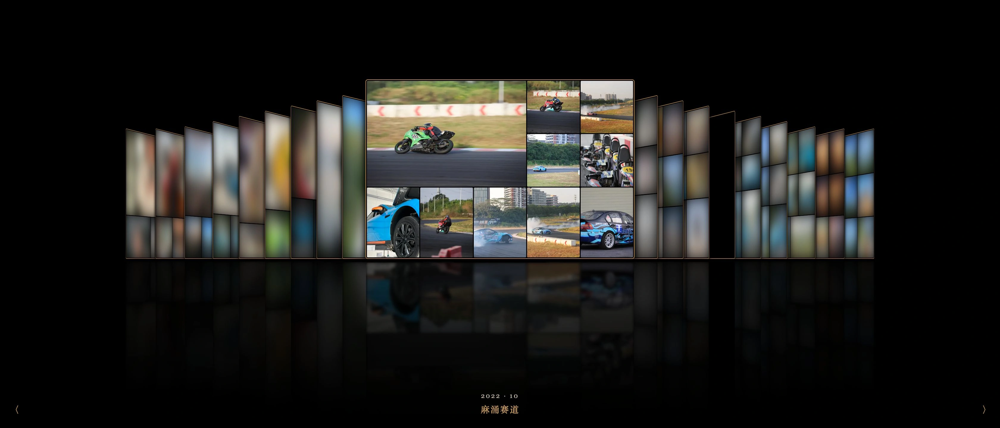
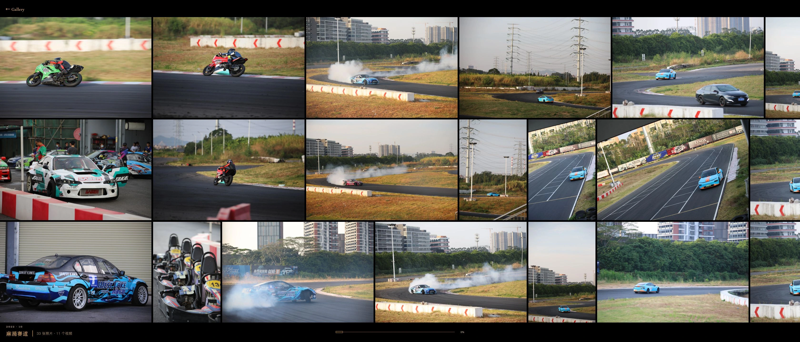
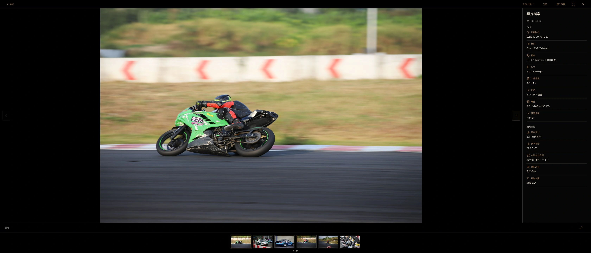

# photo-museum

一部可以不断重看的“人生照片集”。以活动主题作为展览，将照片、Live Photo 和视频组织成个人博物馆。服务目标是自托管于 Mac、内网 Linux 或 Docker，从 NAS WebDAV 只读取得成片。

## 界面预览

以下为 **3360 × 1440（21:9）** 的实际运行截图，使用馆主授权展示的「2022-10-麻涌赛道」样本。Cover Flow 两侧其他活动在截图预览中做了隐私模糊；正式界面没有这层模糊。

**Cover Flow · 以活动为封面**



**照片流 · 按原始比例横向铺开**



**单图查看 · 原图与照片档案**



## 当前能力

- 只读 WebDAV、可暂停恢复的增量刮削、本地 SQLite、受预算控制的缩略图与 4K 缓存。
- Cover Flow、照片流、暗房显影，以及日历、离线地图、器材馆、时空隧道等展厅。
- 本地人物、主体、摄影主题与神经美学分析；人物命名和人工纠正保留在本地。
- 普通条件搜索与关键词词库、可撤销标签确认/排除；可选活动代表性精选，并排比较评分 Top10。
- 可配置 LLM 策展助理，通过本地索引工具筛选、统计并创建展览。

**当前阶段：P2–P6 首版及普通检索、可选代表性精选已实现。** 真实队列与软件验证记录见 [STATUS](docs/STATUS.md)。原生 HDR 的终端覆盖、真实移动设备和主观识别/选片质量仍需单独验收。

最新视觉与交付顺序：[ADR 0005](docs/decisions/0005-p5-exhibition-rooms.md) · [纯黑/黄褐设计语言](docs/design/visual-language.md) · [P5验收与截图](docs/research/p5-exhibition-validation.md)。React/DOM、SVG与CSS透视实现沉浸观展，右侧timeline为年/月/活动三级。

## 运行正式本机服务

```bash
uv sync --locked --all-extras
npm ci --prefix web
npm run build --prefix web
uv run --all-extras python -m photo_museum
```

打开 <http://127.0.0.1:8790>，首次由馆主设置密码、配置NAS。首次使用本地智能模型，先运行 `tools/prepare_models.py` 和 `tools/prepare_geography.py`，详见运行文档。API与独立worker一起启动，Ctrl-C停止；重启后任务接续。NAS始终只读，数据与加密凭据留在被忽略的`data/server/`。

[当前运行与部署](docs/operations/p2-p4-service.md) · [本轮验证](docs/research/p2-p4-validation.md) · [复验skill](.agents/skills/photo-museum-media-validation/SKILL.md)

## 先体验原型

运行说明见[prototype/README.md](prototype/README.md)，当前本机入口为<http://127.0.0.1:8787>。B主题展览、简化F照片墙和暗房细看共用一个WebGL画布；可切换演示素材与已有真实小样。该服务仅供本机P0.5验收，不是生产登录或NAS直连服务。

[验收结果与限制](docs/research/p05-validation.md) · [浏览器验证证据](docs/research/p05-browser-evidence.json) · [可复用验证skill](.agents/skills/photo-museum-webgl-validation/SKILL.md)

## 先看这里

- [库规模与缓存预算](docs/research/library-census.md)：227活动、19,536图片候选；图片双缓存约8.52GB样本外推／35.16GB保守规划场景。
- [历史架构决策](docs/decisions/0002-immersive-viewer-and-inference.md)：历史单canvas决策、4K→原图冲印、同目录近邻补全。
- [观展运行时](docs/architecture/viewer-runtime.md) · [元数据推断](docs/architecture/metadata-inference.md)。
- [历史色彩概念](docs/design/concepts.html)：保留暖白Swiss气质；网页骨架与CSS演示不再作为正式交互蓝本。
- [产品约定](docs/PRODUCT.md) · [推进路线](docs/ROADMAP.md) · [基础决策](docs/decisions/0001-foundations.md)。
- [索引、WebDAV与provider研究](docs/research/architecture-providers.md) · [格式、色彩与媒体实验](docs/research/media-pipeline.md)。

技术方向已确认：Python API＋独立worker，React用于页面与状态，React/DOM与局部渲染负责观展，CSS透视优先实现首版Gallery时光隧道；SQLite放本地盘，暂不拆年表；识别在本地运行；先SDR后原生HDR；首版单馆主密码。

## 本轮可运行工具

需要Python3.11+与uv。正式媒体处理需要系统`exiftool`、`ffmpeg`、`ffprobe`；Python媒体依赖锁定于`uv.lock`。本机核验版本与覆盖范围见媒体报告。

```bash
uv sync --extra media
uv run --extra media python -m unittest discover -s tests -v
uv run python tools/inventory.py --root '/Volumes/Farmer.local/工程/拍照片' --workers 4
# 中断后加 --resume；新快照不加 --resume
uv run python tools/report_inventory.py
```

报告生成需要已完成的`data/research/inventory.json`与媒体实验`results.json`。媒体实验使用明确样本manifest，详见 [发现与容量验证skill](.agents/skills/photo-museum-discovery/SKILL.md)。P1现已实现WebDAV目录增量、Range续传组件和网站鉴权；正式缓存、同名Live候选视频处理与Docker现已接入。独立视频仅索引，不下载；二级目录不处理。

概念可直接打开`docs/design/concepts.html`；若需本地预览：

```bash
python3 -m http.server 8765 --bind 127.0.0.1 --directory docs
```

浏览器访问`http://127.0.0.1:8765/design/concepts.html`。仅服务docs，不暴露私密数据目录。验收方法见 [设计复审skill](.agents/skills/photo-museum-design-review/SKILL.md)。

所有原始清单、元数据、小样图片、缓存、凭据和本地SQLite均不得提交Git；项目根`AGENTS.md`记录常驻约定。
