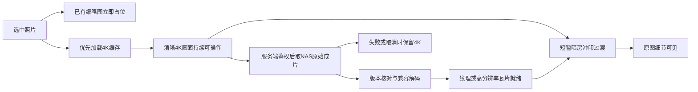

# ADR 0002 — 全画布观展、渐进原图与近邻补全

> 后续修订：[ADR 0003](0003-black-ochre-gallery-home.md)已取代本文的暖白/单canvas要求及A隧道延期顺序。本文保留历史；渐进媒体、推断和隐私约定仍有效。

日期：2026-10-24。状态：用户要求已接受，技术细则为待验证设计。此决策更新ADR 0001的展示架构与元数据流程，不改变Python/SQLite/WebDAV、本地识别、单密码及先SDR后HDR的选择。**本次只调整计划，未实现新的渲染器或推断器。**

## 1. 从网页相册调整为全屏观展应用

A时空隧道、B主题长卷、C日历、D地图、E器材馆、F照片墙/屏保均是同一个Three.js/WebGL运行时中的场景。只有一个持久canvas，切模式改变布局、相机与交互，不重新建立六套图片加载器和WebGL上下文。

暖白纸感、Swiss排版仍保留为场景视觉语言；网页页头、页尾、长文章区块不进入观展。时间线、地点与操作采用克制的场景文字/HUD，空闲时收起；暗色用于单幅细看。React负责登录、管理和必要的语义/输入辅助，照片与六种模式的主视觉由canvas绘制。

进入观展默认填满浏览器视口。浏览器隐藏地址栏的真正全屏需要用户点击“入馆/全屏”并由平台支持；被拒绝或不可用时仍保持视口全屏，Esc和可见退出按钮都能返回。键盘/读屏有对应语义层，不把canvas变成不可操作的黑箱。

详细场景与资源契约：[观展运行时](../architecture/viewer-runtime.md)、[体验规范](../design/experience.md)。旧[概念页](../design/concepts.html)只保留色彩、排版和气质参考，其DOM布局、CSS隧道和灯箱实现不再作为正式实现蓝本。

## 2. 缩略图 → 4K → NAS原始成片

“原图”是已入库成片所在NAS路径的原文件，不是RAW备份或未处理原片。

浏览器通过asset ID与源版本请求本站受鉴权接口；服务端解析保存的NAS原路径、读取WebDAV。浏览器不持NAS凭据，不拼接任意远程路径，也不直接访问NAS跨域URL。

4K取得最高优先级，默认在4K首帧就绪后再启动NAS原图的大流量读取；媒体清单和缓存状态可先并行查询。若高质量缓存已经就绪，可直接使用，不等待4K或被迟到的4K降级。只有当前正在细看的照片自动升级原图，附近照片只预载小图/4K；避免点进一场活动就下载十张原始大图。当前图关闭/切换后取消或降低过期任务，迟到结果必须核对asset ID、source revision和视图generation，不覆盖下一张。

冲印体验分成两个动作：等待时保持清晰4K，用边缘提示或极轻纸面效果表达“原图载入”；目标已完成解码与GPU准备后，再短暂显影/细节浮现到原图。不能把4K先人为糊掉，不能以伪百分比假装真实下载进度，也不能在缓存已命中时故意延迟。快速翻图、减少动态效果或低性能设备直接切换/轻淡入；失败停止等待效果，4K继续可看可重试。变换前后保持方向、构图、缩放中心与用户平移位置。

原文件不兼容浏览器或纹理限制时，服务器从该原文件生成颜色正确的兼容高分辨率图/按需瓦片，明确其为兼容显示。保留请求原文件的能力，但“已下载”“已解码”“已显示原生格式”和“已显示HDR”是不同状态。不能把JPEG/WebP兼容衍生图标为原生HEIC/HDR。

**磁盘缓存预算不等于GPU预算。** 原文件和兼容衍生物按需缓存、参与80GB总缓存上限；原图尺寸、解码内存、纹理和mipmap单独限额。高像素照片细看采用瓦片/LOD方案，不能把整库原图或所有4K纹理常驻GPU。源文件在加载过程中改变版本时丢弃混合结果并刷新manifest。

## 3. 近邻补全成为刮削基础能力

同目录缺失GPS/EXIF的照片，可以利用文件名中的自然编号/时间线索与近邻实测信息产生推断结果。该功能是确定性元数据处理，前移到P1 schema与P2基础流水线，不等待P4本地AI或P6 agent。

不把整份EXIF从一张图复制到另一张图。优先确认同资产不同导出版本的关系，再考虑同目录、同可比较序列内的近邻；不同相机的同名编号、编号回绕、批量重命名、年度汇总和混合旅程都可能破坏邻接关系。没有可信证据时保持未知或待确认。

可推断项主要是地点/地点范围、拍摄时间范围与精度，以及有强证据的设备归属；不能借用邻图的曝光、焦距、ISO、方向、尺寸、ICC/HDR、内容标识、人脸或评分。双侧供体GPS一致时可补近似地点；供体跨城市/旅程冲突时不平均成一条虚构坐标，不把编号相邻当作物理距离相邻。

入库按字段分别保存原始观察、推断候选、人工修订与effective查询值。记录供体asset和版本、方法/规则版本、证据、置信等级、空间/时间精度、适用/冲突状态。搜索/地图/日历可用有效推断值，但能筛选“含推断/仅实测”，详情标明“由邻近照片推断”。人工修订优先，真实EXIF补回后优先于推断；推断值不能再作为供体滚雪球。

GPS逆解析由有效坐标的来源与精度驱动。只有城市级推断时就索引城市级地址，不经逆解析伪造精确街道。新增照片、供体变更/删除、路径组变化或规则升级会使相关推断及地址结果失效并重算，人工修订保留。

详细规则、字段模型与正反例：[元数据近邻补全](../architecture/metadata-inference.md)。

## 4. 调整开发顺序

新增 **P0.5风险原型**，先以少量可控样本验证单canvas场景切换、4K→原图状态机/冲印动画、颜色、缩放、取消竞态和显存回收，再建设正式观展UI。该原型也提前揭示全canvas与未来原生HDR的兼容边界，未验证前不承诺两者天然兼容。

P1同时设计分层元数据与来源依赖、媒体manifest和受鉴权原图代理；P2在统一运行时完成B主题浏览、单幅细看、基础推断与刮削管理；P5的A/C/D/E/F只扩展场景模块。完整阶段与退出条件见[ROADMAP](../ROADMAP.md)。不再先做一套DOM相册再迁到WebGL。

## 5. 本次不扩大执行范围

没有重新扫描或写入NAS，没有启动全量原图下载、GPS请求、人脸分析或推断回填。没有更改P0样本统计；8.52/35.16GB仍仅描述两档静态图的旧实验估算，不能覆盖新增按需原图、瓦片、GPU或模型内存成本。新能力在独立风险原型通过后，才记录为可复用实操skill。
