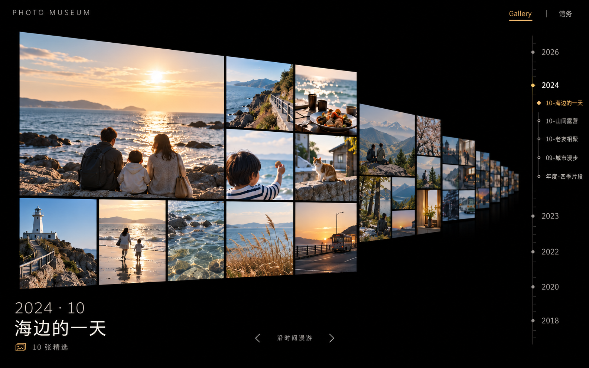
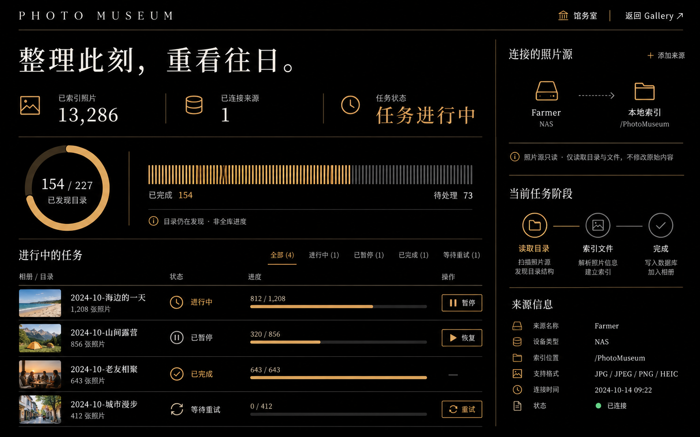
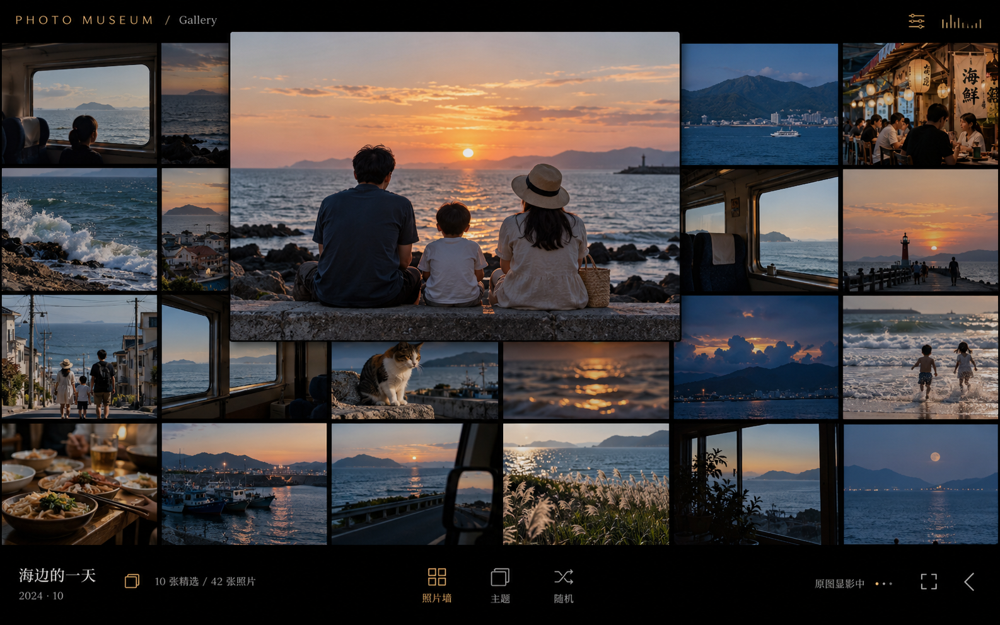
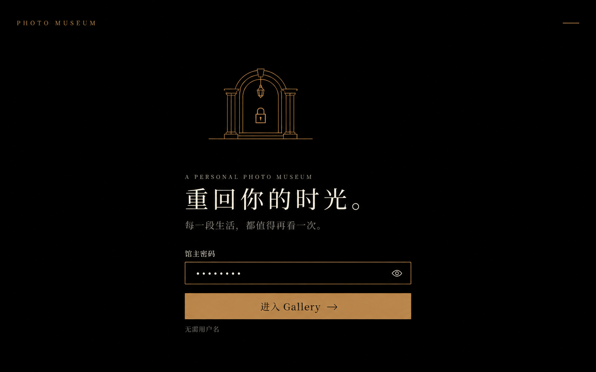

# Photo Museum · 黑底黄褐第二版

2026-10-24。使用内置 image_gen。Gallery 首页沿用用户认可的时光隧道图片并编辑，其余页面新生成。统一纯黑背景、黄褐交互色、细线图标和克制的展签；取消暖白中转主页。图片素材、进度和活动均为虚构，概念不代表功能已实现。

## Gallery 首页 · 时光隧道

## 刮削管理 · 真实进度可视化

## 主题展览／照片墙 · 黑底黄褐

## 馆主登录 · 统一入口

[完整提示词](prompts.md) · [统一设计规范](../visual-language.md) · [决策 ADR 0003](../../decisions/0003-black-ochre-gallery-home.md)

检查记录：Gallery保留整场活动展板的纵深，右侧同月三个主题各占一行，年度项不伪造月份。管理图表明确分母为已发现目录。生成图存在局部衬线字体与小字偏差；正式实现使用规范中的无衬线字体、真实文本与数据。照片墙的附加统计在实际数据可用时才启用；登录概念的Gallery落点随P2交付，当前P1仍进入馆务。
