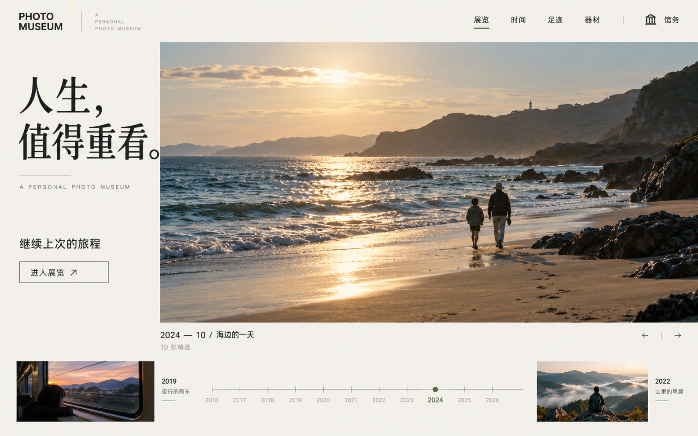
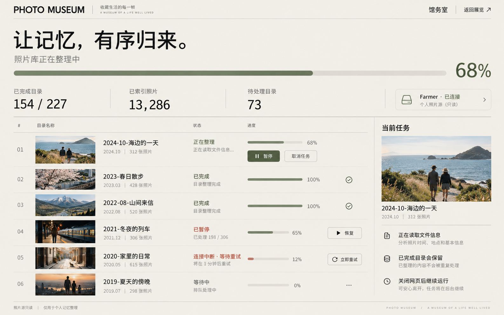
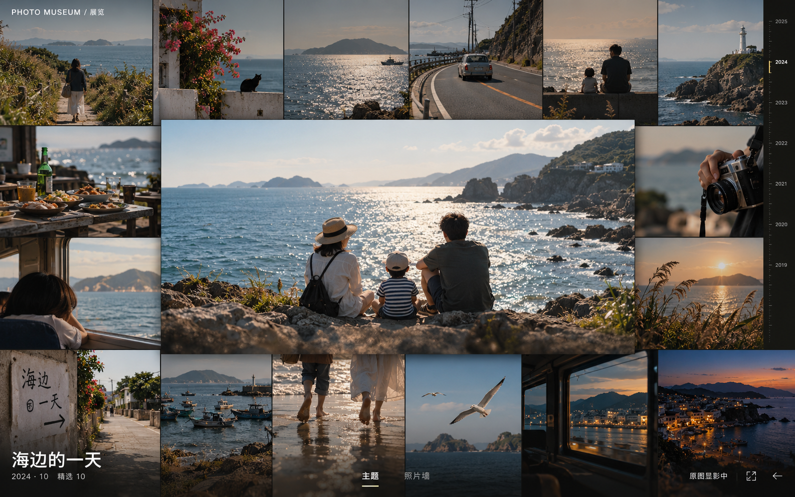
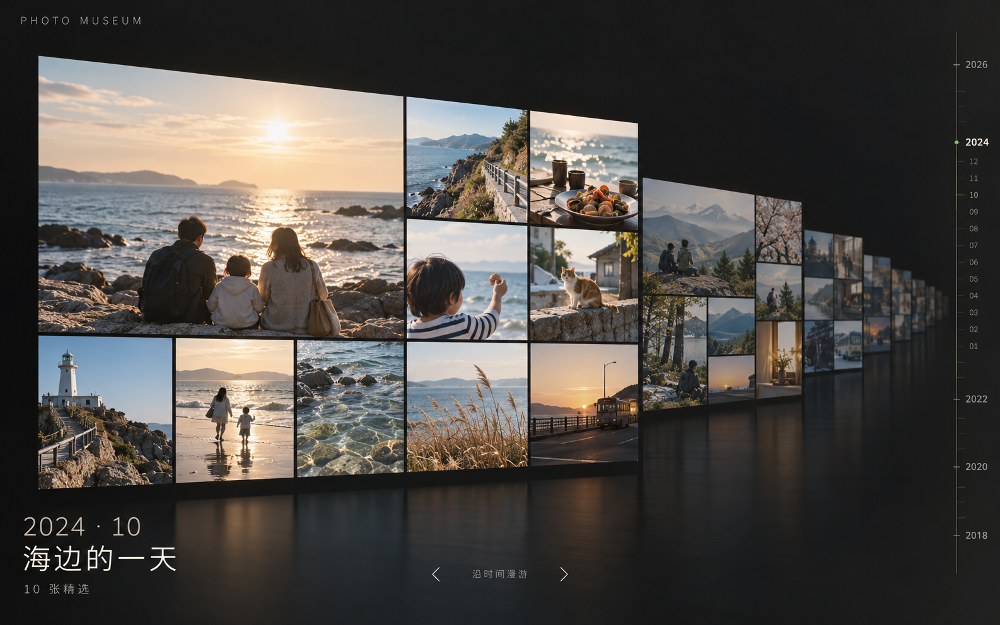

# Photo Museum · 四个界面概念

2026-10-24 · 使用内置 image_gen 生成。均为独立高保真概念图，照片和进度数字均为虚构，不是当前服务截图或功能验收结果。保持暖白纸感与 Swiss 信息排版，沉浸观展采用暗色、全屏与极少常驻控件。

## 主页面 · 人生照片集

暖白纸感的博物馆入口，以人生照片和继续观展为中心。

## 刮削进度管理 · 馆务室

清楚呈现目录进度、暂停、恢复与断网重试；数字和任务状态为概念示例。

## 主题展览／照片墙 · 全屏沉浸

满屏近方形照片墙，点击后的单图浮起；极简浮动信息与暗房显影提示。

## 时光隧道 · 活动精选

每个活动由10张精选组成一层展览，沿时间纵深排列，右侧为时间刻度。

[完整生成提示词](prompts.md)

设计检查：四图已逐张查看，主页面与管理页保持暖白体系；照片墙强调满铺，时光隧道采用整场活动精选递进。生成图中的细小文字、按钮和动画提示仅供构图讨论，落地时使用真实排版与状态。静态概念不能证明全屏、暗房动画或性能已经实现。尚待用户选定后续调整方向。
