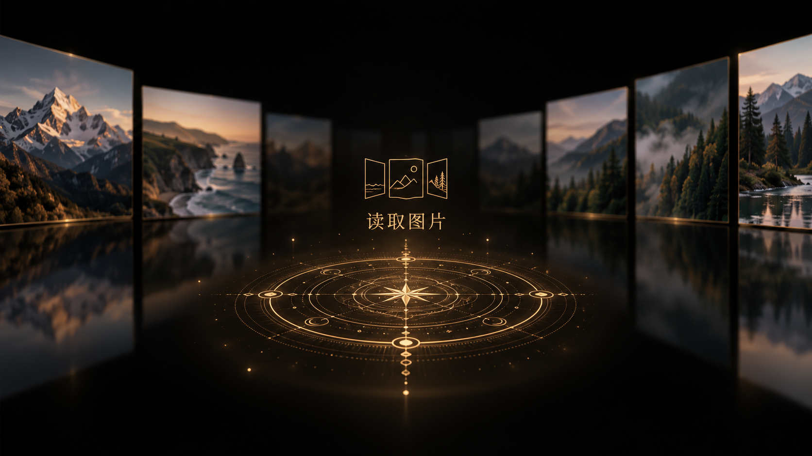

# 读取图片：金色魔法阵概念

2026-10-26，内置 imagegen 生成。仅设计提案，未修改加载组件。全图使用生成的通用风景，没有发送私密照片。黑色半透明遮罩指界面内的局部材质，本张整体概念图没有透明背景。

## 最终提示词

Use case: ui-mockup. Generate ONE polished landscape 16:9 desktop interface concept for a personal photography museum Gallery loading overlay. Existing visual language: pure black background, restrained warm ochre gold #B88B4A and #D8AE72 thin vector-like outlines, elegant minimalist typography, immersive photographic Cover Flow. Background: softly defocused, dimmed horizontal 3D Cover Flow panels with generic mountain, coast and forest photographs, faint dark reflections. No identifiable people or private images. Main request: at the exact screen center place a small gold thin-line folded triptych/photo-album emblem above the exact Chinese text “读取图片”. Underneath this text, draw a black semi-transparent soft mask with a broad feathered transparent gradient on ALL edges: an oval floating veil, never a hard rectangle. Background photographs must remain faintly visible through its edges so transparency is evident. On this lower mask draw a beautiful GOLD CIRCULAR MAGIC CIRCLE, delicate concentric circles, precise radial tick marks, restrained geometric interlacing, fine tiny ornamental marks, a few subtle gold light specks. The emblem and loading words are centered just above the magic circle, the circle is immediately below the words, forming ONE balanced centered loading composition. Magic circle appears as a very slightly perspective-compressed circular floor seal, with sufficient vertical depth to see its intricate design, about 330px wide in a 1600px canvas. The dark feathered mask extends softly around and below the circle, helps legibility but does not hide the whole Gallery. Crisp thin gold line work, faint golden glow, premium quiet museum aesthetic with a tasteful magical ritual feel. Maintain large negative space. Only readable text anywhere is exactly “读取图片”; no percentage, no slogan, no website branding, no fake browser chrome, no additional UI labels, no watermark. This is a high fidelity product concept, not a fantasy scene or game poster.

生成图的魔法阵比提示词里的330px更大，属于本版视觉结果；图标也是生成的馆徽近似表现。真正实现时仍应复用项目MuseumMark，不以该位图替换正式logo。概念不代表已实现透明度、动画或真实加载状态。
