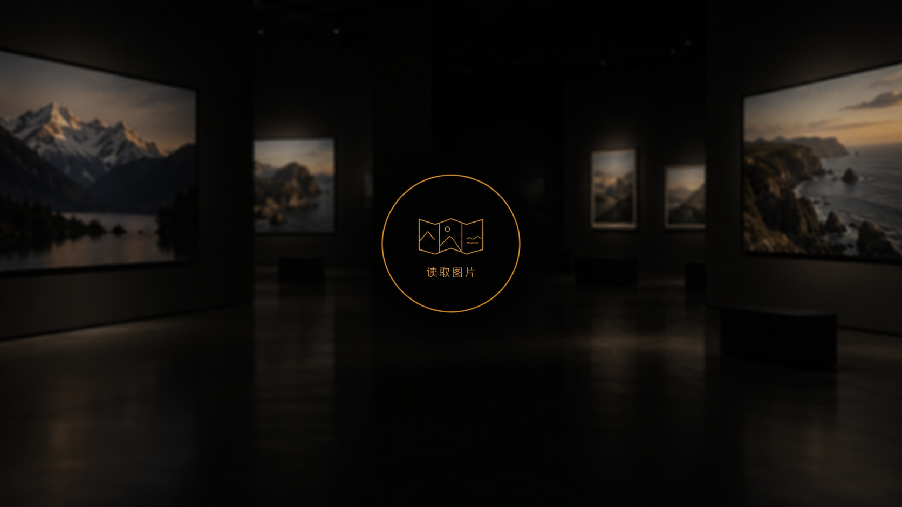

# 读取图片：简洁二维圆环

2026-10-26，内置imagegen生成，替代前版魔法阵设计方向。仅概念，未改代码；正式实现仍复用MuseumMark。一个二维细线圆包裹馆徽与文字，局部黑色羽化遮罩，无魔法符文、粒子和加载图形透视。

## 最终提示词

Use case: ui-mockup. Create ONE minimalist 16:9 Photo Museum Gallery loading overlay concept, radically restrained. Flat TWO-DIMENSIONAL front-facing geometry only. At the exact center of a dark black interface draw ONE perfect simple circular outline in muted warm gold #B88B4A, extremely fine stroke, diameter about 230 pixels in a 1600px-wide canvas. INSIDE the circle, centered together, place a small fine-outline gold emblem showing three folded photograph panels, and directly beneath the emblem the exact Chinese text “读取图片” in small refined plain typography. Both emblem and words must fit comfortably INSIDE the circle with generous inner padding. Circle is a pure flat circle, not an ellipse, no perspective. Behind this small centered circle use a subtle local black semi-transparent veil with softly feathered transparent edges, only to keep the symbol legible. Background: a VERY dim and slightly blurred photography gallery with generic mountain and coastal photos as faint peripheral rectangular panels on pure black, unobtrusive, no people. Large quiet negative space. Extremely restrained minimalist black-and-ochre Swiss-inspired photography museum UI. All graphics should look easy to implement with plain SVG fine strokes. STRICTLY NO magic circle, NO runes, NO radial tick marks, NO ornamental symbols, NO extra rings, NO particles, NO sparkles, NO volumetric light, NO glow, NO reflections beneath the loading symbol, NO three-dimensional loading graphics, NO giant text. Only readable words are exactly “读取图片”. No branding, no slogan, no buttons, no browser chrome, no captions. The single thin circular outline encloses BOTH the little logo and the text.
