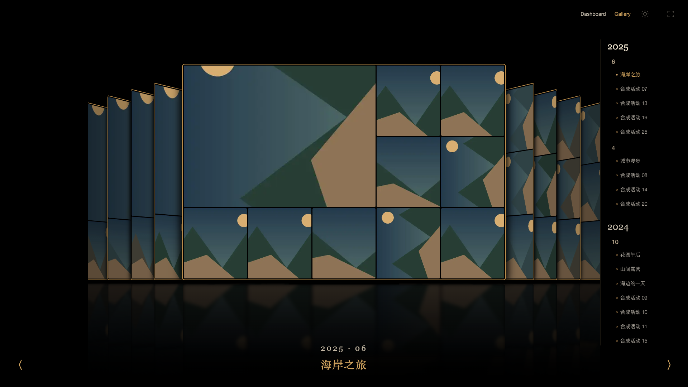
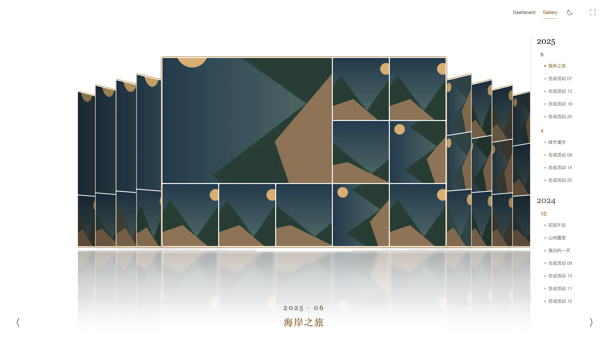
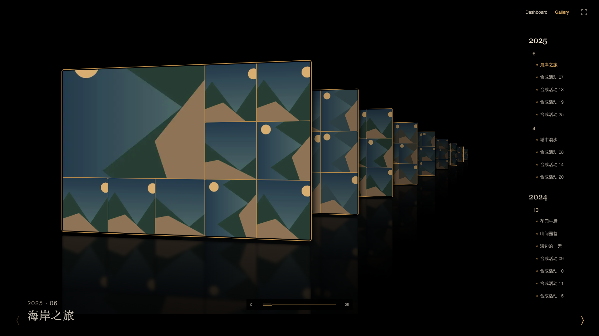

# Cover Flow 与时空隧道封面细化

2026-10-25。沿用四款 Cover Flow 的布局、评分Top10与本地缓存，调整封面材质和屏幕密度。

## 实现

- 黄褐外框从细线统一为2px，里面加3px夜黑/日白内框；外框6px、单张拼贴3px圆角。投影向四周延展，照片亮度滤镜不再压暗外框。
- 镜面不带边框、轮廓或投影，保留圆角及不透明黑/白底，仍以前景遮挡后景。图像模糊从约2px提高到5px，地面再加3px背景模糊，末端完全融入页面底色；封面与镜面相隔14px。
- 1280×720、1440×810、1600×900、1920×1080统一9张封面，中央1张、两侧各4张。手机5、平板/矮屏7、宽屏13、超宽屏19；活动不足时只用真实活动，保持两翼对称。
- 实际截图发现纵深/弧幕旧几何会把外侧封面裁出画面。改为按透视投影后的外沿分配空间，保留角度、缩放与主封面中轴，四款桌面样式都实际露出9张。
- 时空隧道沿纵深使用同一数量预算；临近最后活动时自然减少后续画板，不循环伪造未来活动。减少动态效果时只留当前画板。

## 证据

公开截图使用合成照片。响应中的合成活动扩展至25项以测密度，未更改正式索引；真实照片检查仅存忽略的data目录。边框和密度不需要重新刮削或请求NAS原图。

- `node --test web/tests/cover-layout.test.mjs web/tests/radial-layout.test.mjs web/tests/timeline-collage.test.mjs`：14项通过。
- `node web/tests/cover-finish.mjs`：[专项证据](cover-finish-evidence.json)，四样式日夜边框/圆角/投影、实际命中9封面、9种屏幕规格、镜面像素遮挡、时空隧道控件、减少动态效果、零原图请求。
- `node web/tests/coverflow-resize.mjs`：[6项通过](cover-finish-resize-evidence.json)，保留活动ID及连续滚动进度，覆盖390手机、701×541临界矮屏及3440超宽屏。
- 原生返回与加载专项：[回归证据](cover-finish-navigation-evidence.json)。
- 日夜模式：[12项回归](cover-finish-light-evidence.json)。修复刚切换活动就刷新时，500ms合并写入尚未落盘而被旧历史快照覆盖的问题；在beforeunload提前刷新已有待写快照，不拦截离开、不弹确认，也保留滚动写入合并。

强模糊后的接缝会采样相邻表面，镜面遮挡像素断言在内部64px处进行，接缝与圆角另作截图复审；不通过删除模糊或让整个镜面半透明来迎合测试。

GPU重绘的8bit量化实测最大差1，像素检查允许每通道最多1/255差异，仍拒绝明显的后景颜色渗透。测试使用现有Playwright锁定包的PNG解码，不新增运行时依赖。

## 正式页面复查

正式8790前端已替换静态构建，保留旧哈希资源以兼容已打开的页面，最后原子替换index。API与后台worker不重启。现有馆主会话实测夜黑/日白3px内框、2px金框、6px圆角、无轮廓5px镜面；Cover Flow为9张，时空隧道中段同样9张在视口内（另有1张已离开视口的退场缓冲板）。两厅真实截图仅保存在`data/cover-finish/`。返回Cover Flow后保留其浏览位置，独立fixture已停止。

