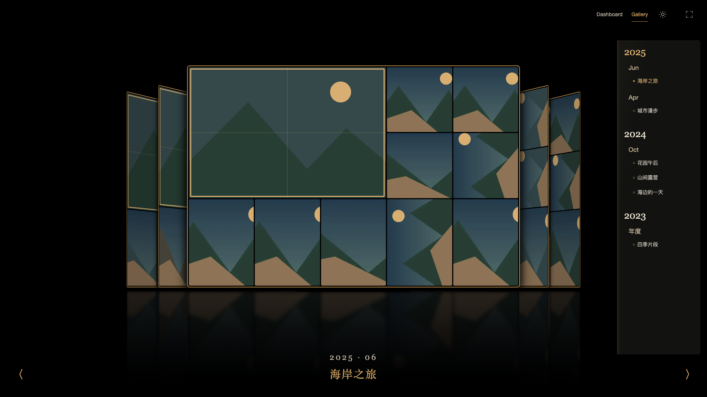
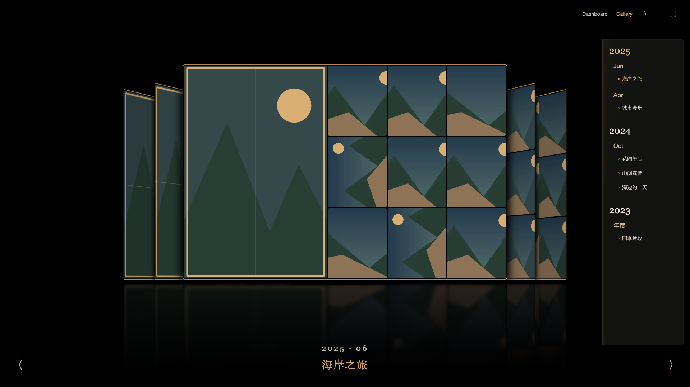
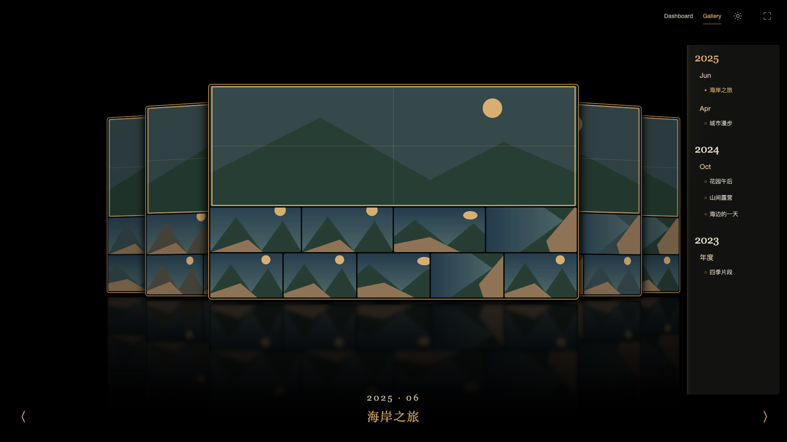

# Cover Flow 头图比例

2026-10-25。金框画廊和全景弧幕的旧十图模板把头图固定铺满上半部，3:2照片被裁成约3:1或更宽。已移除此强制模板，四款Cover Flow共用按比例规划的拼贴。

头图继续是服务端评分Top10的第一张，不重新挑选或排序。依据已索引的宽高选择模板：普通横幅在左上、竖幅沿左侧、近方幅在左上较方的区域；实测宽高比至少2.4才使用整行宽幅头图。头图区域的行高/列宽随比例调整，保留合理上下限以给其他9张留空间。未知尺寸安全回退普通横幅；少于10张沿用现有小集合布局，不硬塞十张。倒影共用相同的class和布局参数。

不改变封面外形、9张桌面密度、评分、缓存版本、源照片或数据库，也无需重刮。缩略图仍来自本地缓存。

## 验证

- `node --test web/tests/cover-mosaic.test.mjs web/tests/cover-layout.test.mjs`：9项通过。
- [7组浏览器专项](cover-hero-evidence.json)：4款×4种头图形状、手机4种、日间1种，共21次实际几何测量。合成SVG的内在比例与注入元数据一致，按`min(槽位比/原图比, 原图比/槽位比)`估算裁切保留比例，样本最低约97.0%；非宽幅头图均未铺满整行。
- 检查全部十图在封面内且互不重叠、服务端排名顺序不变、镜面参数一致、0/1/2/3/7/9张小集合回退、零原图请求及未捕获错误。
- [6项跨屏回归](cover-hero-resize-evidence.json)通过，活动保位及转正不变。
- 公开截图仅合成图，所有小图及倒影解码后才保存。真实图库截图仅放data/cover-hero/。样本比例不代表任意极端宽高比均无裁切，其他9张小图仍允许合理裁切。

正式页面复查：旧正式进程在本轮部署检查前已因SQLite锁错误退出，确认无残留进程占用数据文件后沿用现有data/server恢复API及workers；本轮未修改数据库锁策略，不把恢复运行当成根治证据。新静态包已上线，真实竖幅头图内在宽高比约0.6672、实际槽位约0.6689，十图顺序和数量保留。截图仅存data/cover-hero/formal-gallery.png，Gallery保持打开，独立fixture已停止。

