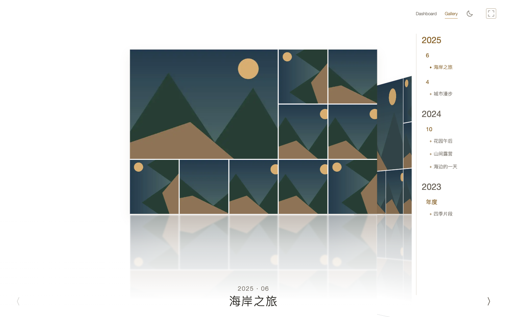
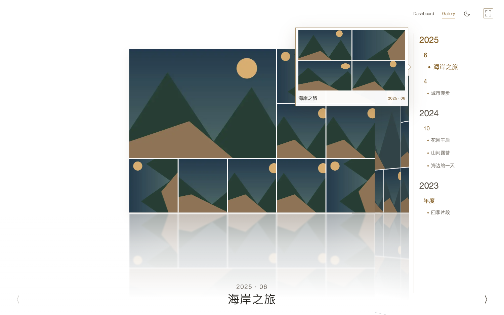
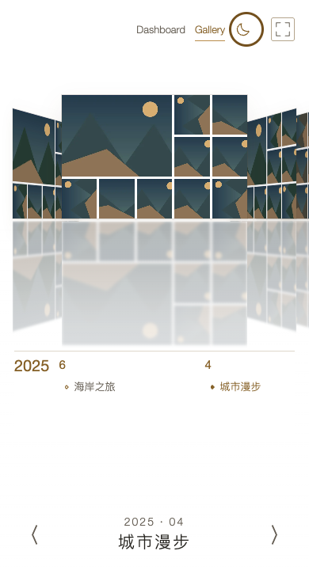

# Cover Flow 日夜模式

2026-10-25。用户新增 Cover Flow 白天模式，作为既有全黑规范的局部例外。默认仍为黑夜；右上 Gallery 与最右全屏之间新增太阳/月亮 SVG 按钮，图标表示切换目标，并提供操作名称、键盘焦点和 aria-pressed。

黑夜底色 #000000；白天底色 #FFFFFF，正文 #25231E、次级文字 #655E54、交互文字 #866128。仍保留黄褐色系；活动标题、年月、前后箭头、导航、菜单、选中态、焦点、占位和错误都适配。时间线预览挂载在 body 的 portal，显式接收局部主题，避免只改父节点导致气泡漏改。

白天倒影保持不透明白底遮挡，用白色渐隐和毛玻璃淡出；没有用反色滤镜影响照片。切换记忆只保存在当前浏览器 localStorage，不改服务器偏好。照片墙、暗房、Dashboard及其他展厅继续黑底；返回 Cover Flow 恢复上次模式和活动位置。存储被禁用时仍可切换。

修改前保存 [独立配色基准](../design/coverflow-lightmode.html)，实现基于现有 CSS 透视及 SVG 图标，不新增依赖或修改媒体/分析流程。

验证：隔离 Vite 构建通过，`node web/tests/coverflow-light.mjs` 12 项专项通过。覆盖1500×940、1280×640、390×720整页无滚动/控件完整，日夜切换与重载保位、照片墙返回、其他展厅范围、减少动态效果、禁用存储、Portal气泡、零额外原图请求及零外网请求。白底关键文字对比度≥4.5:1；主图内部裁片日夜截图字节一致，倒影像素测试确认后方颜色不透过前方镜面。无浏览器未捕获错误。

另有26项P5展厅回归通过，涵盖共享照片墙/暗房、四展厅、返回位置与资源释放。正式前端已原子切换index并保留旧assets，HTTP逐文件字节核对通过；后端与刮削进程无需重启。

[专项机器证据](coverflow-light-evidence.json)、[P5回归](coverflow-light-p5-evidence.json)。全部公开图为84张程序生成图片及合成元数据，不含用户图库、GPS或真实NAS。只验证显示配色，不把合成截图当物理色彩/HDR验收。

