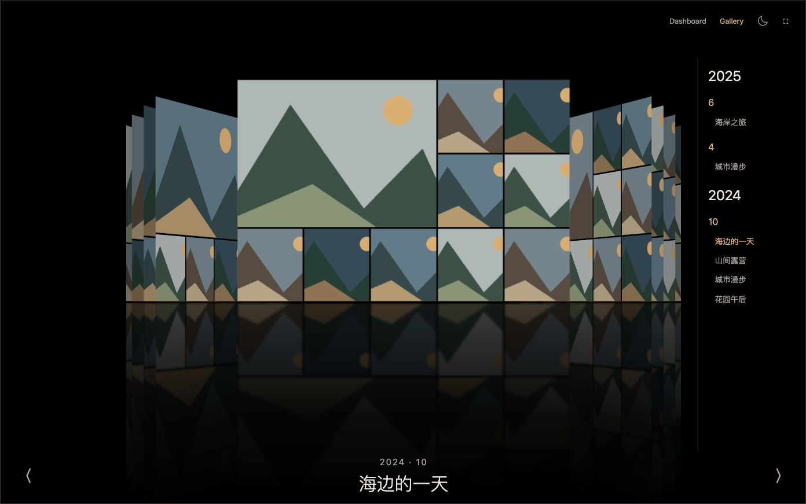
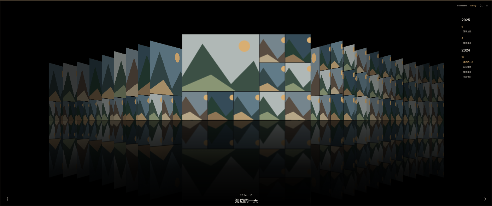

# Cover Flow 响应式排版建议

2026-10-25。根据当前 `web/src/exhibition.jsx` 与 `gallery.css` 的尺寸/透视计算进行设计分析，未改正式界面。当前经典Cover Flow与日夜模式继续运行。

[交互排版预览](../design/coverflow-responsive/index.html)可切当前公式/建议方案、黑夜/白天、10种尺寸或自定义宽高。画面为程序绘制的合成拼贴，不含用户照片。它是独立几何草案，不模拟生产手势、NAS或精确命中/加载表现。

## 先解决尺寸跳变与视觉重心

当前只有700px一个主要断点。宽度大于700时先减去282px轨道空间，封面宽度再受 `max(120, width-584)` 限制。同为900px高，700px宽时封面420px，701px宽仅120px；768px宽也仅184px。由当前代码公式计算，不是用户图库抽样。这会让平板、小桌面呈现过小封面与过大的时间线。

另外，中央按全屏居中，而封面层只在右侧裁掉282px，导致两翼可见空间不对称。保留用户已经确认的“中央封面/标题对齐屏幕中轴”，为两翼建立对称安全范围；时间线只占最外侧区域。窄屏用折叠导航，不把中央舞台挤向左侧。

## 推荐的视觉层级

中央封面展示照片，最近的一对侧封面体现Cover Flow，远处几层提供方向与纵深。挂载预算继续5–20，但不能把“驻留20块”等同于“同时让20块都抢眼”。主封面尺寸、两翼清晰层数与资源驻留数量分别计算。

- 手机约320–599px：5块驻留。主封面约屏宽的三分之二，保留两侧各1–2层边缘。纵向放在中部稍上，标题和左右操作留底部；不为倒影压缩主图。
- 平板与小桌面约600–1249px：7块为主，宽端可驻留9块；主封面约400–530px，并受窗口高度限制。时间线收成单个年月入口，展开后仍为年/月/活动三级，不删除任何导航层。
- 笔记本与桌面约1250–1999px：9–11块驻留，醒目可读的是中央和最近两三层。保留约184–248px右侧时间线，主封面以高度及对称舞台预算约束，避免两翼挤到轨道下面。
- 超宽屏约2000px以上：15–19块驻留，保留20块上限。主封面到约900px封顶，多出的空间给两翼间距和倒影，不再同比例放大主图。远侧逐级缩小、略增倾斜并变暗，形成纵深。
- 窗口高度不足600px：高度优先，限制两翼密度；保留标题与44px操作命中区。倒影可延伸到底，但更早淡出，不能与照片争夺高度。

这些是设计区间，不应实现成主封面在断点处跳变的常数表。建议用连续插值分配主封面宽度和轨道安全范围，轨道在约950–1250px范围逐渐让出空间；窄屏导航与完整轨道在约1250px切换。挂载集合切换时稳定保留选中活动及邻居，不能改变滚动位置。

## 酷炫来自运动和纵深

主封面停下后严格正面，拖动时两侧角度随连续位置过渡；侧封面约58–62度，远侧再略增加角度并缩小。每层应露出可辨认的条带，而不是十几条同宽细缝。黑夜以更暗远景退后，白天以较弱对比度和柔和投影退后；不要把白色倒影加亮成灰墙。

倒影保持前后遮挡，不用整块面板透明度叠加。主倒影较清楚，两翼更弱；把模糊集中在镜面，不把文字/主图做毛玻璃。主封面与标题、左右操作之间保持呼吸空间，滑动动画优先保证连续帧和可中断，避免增加无意义的摆动。

## 已验证与待决定

独立模型在390×844、700×900、701×900、768×1024、1024×768、1280×640、1440×900、1920×1080、3440×1440、844×390十组尺寸渲染。另按900px高度逐像素检查320–3440px宽度，建议模型主封面不存在大于3px的相邻宽度跳变；700/701px建议约412/413px。黑白与当前/建议切换、390px报告控件、无横向文档溢出及本地文件离线打开通过，见[机器记录](coverflow-responsive-evidence.json)。

“约1250px以下折叠时间线”是本方案最重要的产品取舍，尚未当作正式规范接受。预览中的折叠入口只用于占位表达布局，三级展开交互尚未制作；生产的拖动、Dock气泡、场景过渡、照片墙返回和真实设备流畅度需在落地后另验，不能把此模型验证当成正式验收。

本地预览服务保留在 http://127.0.0.1:8799/design/coverflow-responsive/ ，只服务公开docs；也可直接用浏览器打开同目录index.html，保留相邻layout.js。
