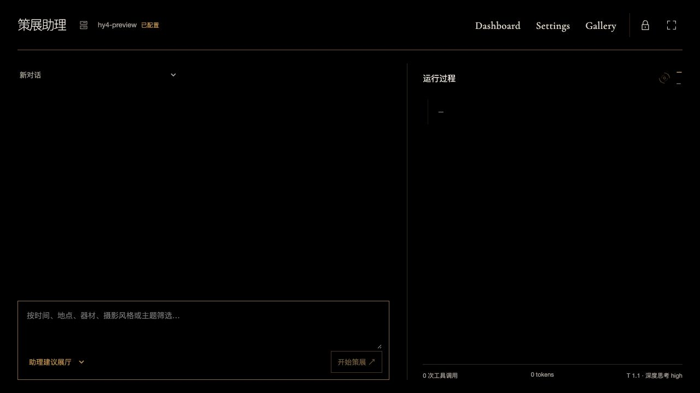

# 策展助理新对话入口

日期：2026-10-27。

## 行为

普通 `#curator` 入口每次显示空白新对话。读取 Provider 与历史列表只提供配置和可选记录，不再自动选择最新任务。记录下拉首项为“新对话”，选择后清除当前要求、结果、展厅草案、预览状态、续写选项和运行记录，同时关闭旧 SSE。

手动选择记录及显式 `#curator?run=…` 链接仍回放指定历史；刷新历史链接不创建任务。临时前往 Settings 后的上下文返回保留显式链接。离开后从 Gallery 菜单重新进入则是新对话。此变更不删除历史、不取消后台任务、不自动提交新的模型请求。

组件监听同页 hash 变化，处理未卸载情况下从历史链接回到普通入口的情形。提交响应带入口代次校验，旧页面提交的迟到响应不能占据新对话；旧取消响应也不能覆盖新选择。

## 验证

- Vite 隔离构建通过，236 模块；依赖和锁文件无变化。
- `node --test web/tests/curator-timeline.test.mjs`：4 项通过。
- 使用 `tools/p5_validation_server.py`，设置 `MUSEUM_VALIDATION_CURATOR=1`，隔离端口 8798、本地 FakeLLM、84 张合成照片；无真实 NAS 和付费 Provider 调用。
- CUA 浏览器操作验证：已有历史时普通入口为空；手动选择记录能回放结果和 10 条可视事件；选择“新对话”后旧草稿、结果、续写选项、事件均清空；历史链接刷新仍回放；设置上下文返回可恢复指定历史；从 Gallery 菜单进入重新空白；刷新空白入口仍保持空白。
- 两次有意提交生成两条合成历史；上述浏览、回放与刷新未产生额外任务。1280×720 无页面溢出。
- 新增相同路径的浏览器回归断言到 `web/tests/curator-timeline.mjs`，语法检查通过；完整旧浏览器脚本本次未单独运行，新增路径由 CUA 实际操作复验。
- 正式 8790 仅更新静态资源，API/worker 未重启。真实已有历史的页面验证：`#curator`、空输入、无当前 run、无事件、下拉选择“新对话”；未提交真实策展任务。

合成界面证据：

