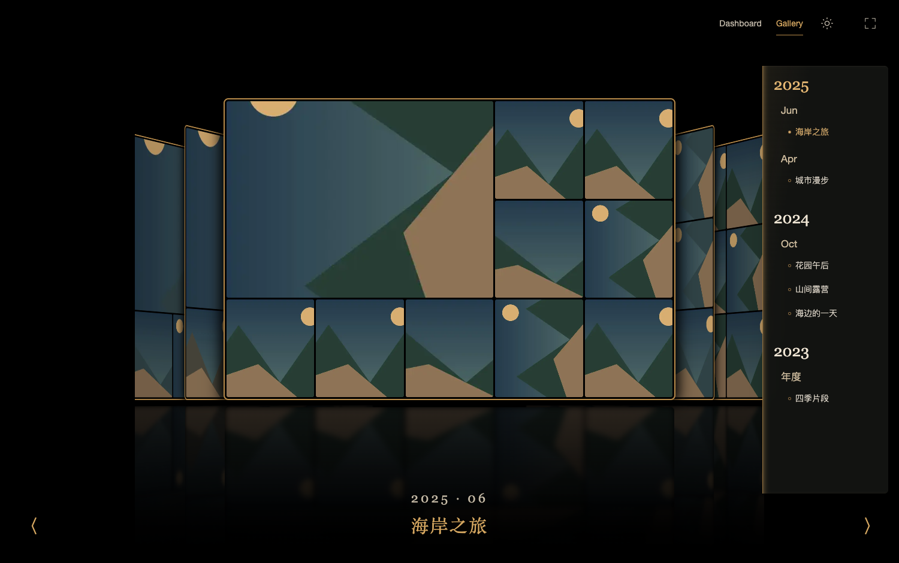
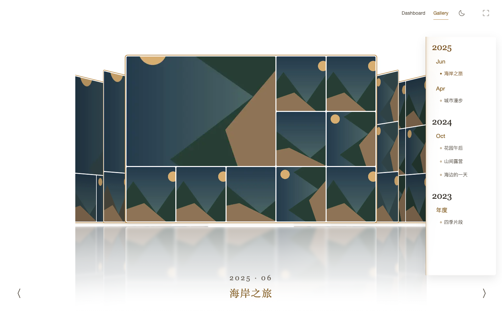

# Cover Flow 时间线毛玻璃

2026-10-25。仅调整Cover Flow时间线，其他展厅和预览气泡沿用现有外观。

面板采用20px背景模糊、115%饱和度、深色烟灰/日间乳白半透明底色及6px轻圆角。年份、月份、活动与选中项使用独立的不透明文字颜色。左侧1px黄褐竖线配8px内投影，光线向右窄幅衰减；手机横向时间线改为上沿向下投光。保持原有Dock放大、列表滚动和Portal气泡。

最终构建曾因前缀顺序只保留-webkit-backdrop-filter，已调整为前缀在前、标准属性在后；浏览器实测为`blur(20px) saturate(1.15)`。不支持背景模糊时使用更实的底色保证阅读。

验证：

- 构建通过；[12项日夜回归](timeline-glass-light-evidence.json)与[15项气泡交互回归](timeline-glass-preview-evidence.json)通过，包括手机、矮屏、键盘、减少动态效果、滚动关闭与Blob释放。
- [极端底色测算](timeline-glass-contrast.json)：夜间按纯白背板、日间按纯黑背板，并叠加最大黄褐底色。夜间最低文字对比度约5.01:1，日间约4.67:1；文字不透明，满足4.5:1目标。这是保守的均匀底色合成测算，不冒充所有硬件上的色彩实测。
- 人工复查桌面日夜及390px手机截图，检查窄光晕、表面层次、文字和控件遮挡。公开证据全部为合成图库，真实页面截图仅存data/timeline-glass/。

正式8790已更新静态资源，现有馆主会话核对20px背景模糊、烟灰透明底色、不透明文字和向右内投光；Gallery保持打开，API/后台刮削未重启，独立fixture已停止。

