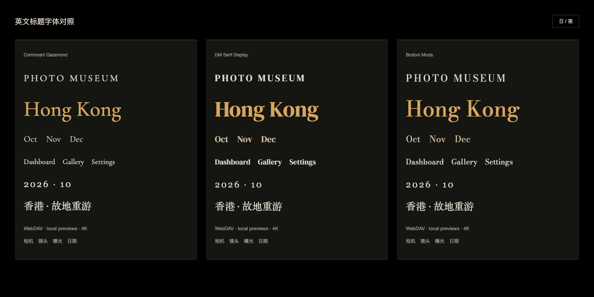

# 英文标题字体

2026-10-25。选用 **Cormorant Garamond Medium（500）**，使用本地别名Museum Editorial。它的字形较舒展、带有图录感；对照后比DM Serif Display的厚重轮廓、Bodoni Moda较冷的高反差更适合本项目。这是视觉判断，不是字体优劣的客观排名。

先做[三款字体对照页](../design/typography-comparison.html)，检查PHOTO MUSEUM、Gallery、Dashboard、Settings、月份及中英数混排，再落实到应用。

## 应用边界

- 英文活动标题、管理页品牌、各页英文栏目/标题及月份使用新字体；技术参数、表单、正文继续使用原UI字体。
- font-face的unicode-range仅覆盖英文字母及常用带重音拉丁字母，排除数字和中文；Gallery标题继续回退Georgia/Songti，其他标题回退原Inter/Helvetica Neue/PingFang栈，不修改原有中文/数字字重。
- 为匹配展示字体的小写字高，桌面顶部栏目18/17px、月份20px；手机适度收紧，保留既有控件点击区域和数字、中文、正文层级。320px Settings标题栏另作间距调整。
- 正式应用仅增加一个23,260字节的WOFF2文件，文件未修改，运行时无Google Fonts/CDN请求。OFL版权及许可包含在最终dist/assets/licenses；[来源和哈希](../../web/src/assets/fonts/manifest.json)随仓库保存。

## 验证

- 构建通过；字体文件及随包许可的SHA256与manifest匹配。
- [6组专项](title-typography-evidence.json)：字体真实加载、中文/数字保持、英文字形改变、多尺寸控件不交叠、字体请求失败回退、无运行时外网请求/未捕获错误。
- 在UI/display两种原字体栈、300/400原字重下以Canvas同坐标逐像素比较：中文和数字像素及宽度完全一致，英文字母发生预期变化。此证据不代表各操作系统都具有相同的中文后备字体，只证明每个浏览器中的原有后备栈保留。
- Gallery覆盖1500×940、390×844、320×720、844×390；Dashboard、Settings、Curator覆盖桌面与320/390。只读打开策展页面，不发送LLM请求。
- [15项时间线气泡回归](title-typography-timeline-evidence.json)通过。截图仅为合成图库；真实图仅保存在data/title-typography/。

正式8790已更新静态包，现有馆主会话核对Dashboard/Gallery英文标题已使用新字体，年度数字仍使用原Georgia栈；截图在data/title-typography/formal-gallery.png。字体许可的静态URL返回完整OFL文本。API与后台worker未重启，两个独立验证服务器均已停止。

## 公开来源与许可

- [Cormorant作者仓库](https://github.com/CatharsisFonts/Cormorant)：展示字体设计及作者信息。
- [Cormorant Garamond OFL](https://github.com/google/fonts/blob/main/ofl/cormorantgaramond/OFL.txt)：随包保留完整许可及版权声明。
- [DM Serif Display说明](https://github.com/google/fonts/blob/main/ofl/dmserifdisplay/DESCRIPTION.en_us.html)、[Bodoni Moda来源](https://github.com/google/fonts/blob/main/ofl/bodonimoda/upstream_info.md)：候选设计来源。候选资源和各自许可保存在docs/design/typography-fonts中，不进入正式应用运行包。

