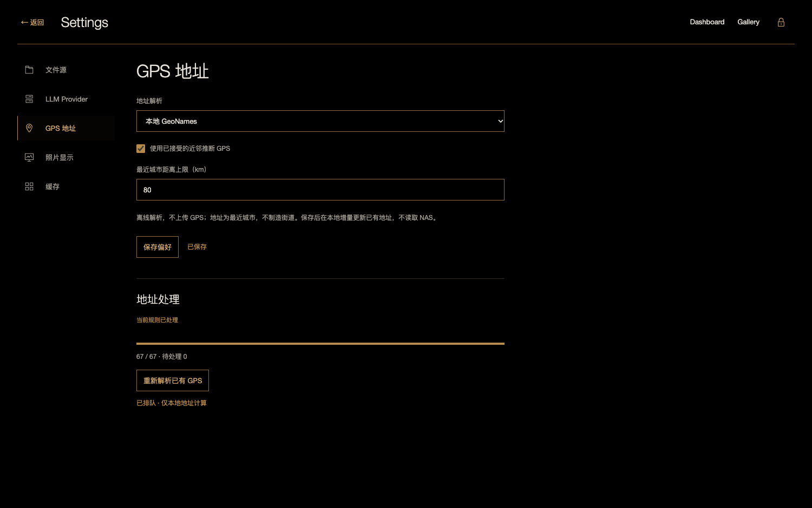
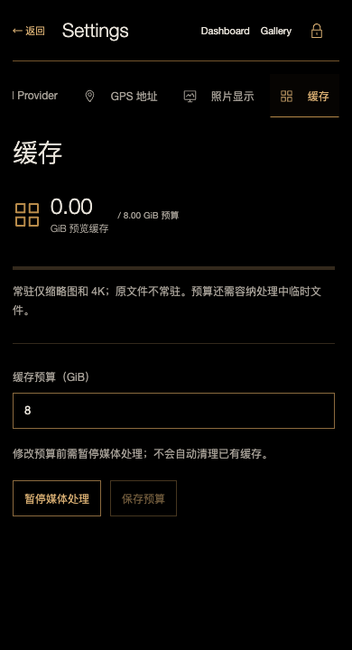

# 统一 Settings 验证

2026-10-25。独立 `#settings` 页面集中管理文件源、LLM Provider、GPS 地址、照片显示和缓存；Dashboard、Gallery 菜单及策展页 Provider 按钮共用此页。布局基准先存于 [HTML 概念](../design/unified-settings.html)，决策见 [ADR 0007](../decisions/0007-unified-settings.md)。

文件源可新建、测试、选择活动扫描，编辑名称、账户、密码与受信 CA。地址和根目录属于源身份，变更时新建源，避免旧索引指向其他文件。已存密码和 API key 不回填；留空保留，由服务器重新加密保存。Provider 延续已有模型、temperature 和深度思考协议，编辑时不调用付费接口。

GPS 支持本地 GeoNames、暂停解析、是否使用已接受的推断 GPS、最近城市距离上限和主动重算。距离/推断设置变更会版本化并逐项重算本地 GPS，地图、照片档案、Dashboard 与策展检索共享过滤规则。暂停保留旧地址，原始 GPS 和人工修订均保留。默认规则继续使用原地址版本，不因新增 Settings 全库重刮；不提供尚未实现的在线地址服务选项。

照片显示支持自动/点按后读取 NAS 原图，准确 SDR/设备支持时尝试原生 HDR。原生解码失败回退 SDR，4K 始终保留；关闭后取消请求、移除临时解码图片 src、撤销原图 Blob URL。只改变单次浏览行为，thumb/display 仍为 sRGB SDR。缓存页面显示账本预览占用与预算，复用暂停/恢复和预算接口，不自动清理缓存。偏好 revision 防止多个页面静默覆盖。

本轮验证：

- `uv run --all-extras pytest -q`：111 项通过。新增 4 项集成测试覆盖鉴权、严格输入/冲突、无源/媒体副作用、留空凭据保留、源身份保护、本地地址重算与暂停、推断规则和事实保留。
- 隔离 Vite 构建通过。`node web/tests/settings.mjs`：11 项检查通过，含 1500×940、1280×640、390×720，所有分类整页无滚动，内容内部滚动。
- 按需模式进入暗房为零 original 请求，点按一次仅一次；模拟 HDR 设备声明及原生解码失败，验证恰好一次 SDR 回退，失败和已显示的两份原图 Blob 均撤销。画板预加载所持有的其他 Blob 不误判为原图泄漏。
- P6 11 项回归通过，包括统一 Provider 编辑、返回策展、流式过程、重连/取消/空结果、六种集合展示和手机布局。

Dashboard 加载/更新失败/恢复与设置入口另通过7项浏览器检查、8种状态断言。

机器证据：[Settings](settings-browser-evidence.json)、[P6 回归](settings-p6-evidence.json)、[Dashboard 回归](settings-dashboard-evidence.json)。公开截图均为 84 张程序生成图片、合成 EXIF/GPS、三个生成城市记录和 fake LLM，不含用户照片、真实 NAS 或真实 API key。本轮不调用真实 LLM，不以模拟动态范围声明冒充物理 HDR 屏幕验收。

正式服务切换与运行检查见 [执行日志](../logs/2026-10-25-unified-settings.md)。
