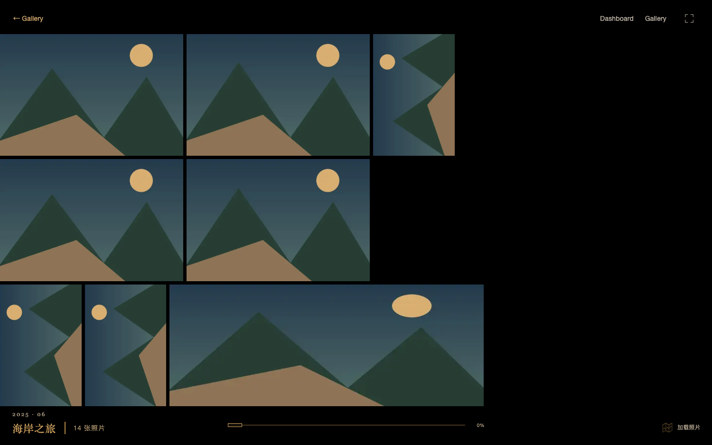
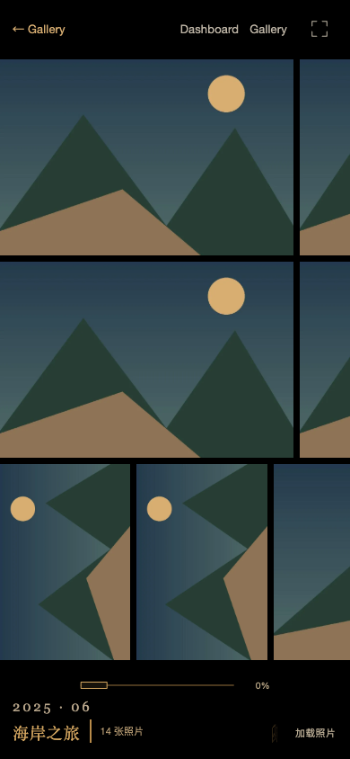

# 照片流缩略图升级4K的闪烁修复

2026-10-25。

原实现把4K标记ready时即移除缩略图，但4K的透明度刚从0开始，产生短暂暗帧。预热Blob稍后到达，还会把同一图片的HTTP地址换成Blob地址，触发再次解码；原decode异常也被忽略。

现在先等待缩略图绘制，再固定一次加载地址。4K解码成功并经过绘制机会后进行280ms淡入，缩略图在下面保持不透明，淡入完成才清除缩略图src和临时合成提示。解码失败继续展示缩略图；虚拟瓦片卸载清除src、取消待绘制任务，忽略晚到结果。预热Blob仍由共享调度器释放，不由单个瓦片撤销，也不请求NAS原图。

照片流分页及进入活动时的“加载照片”统一放右下角，手机为16px边距、桌面24px；加载期间展签预留空间，避免遮挡活动信息及居中横滚条。不把单张详情的原图/显影状态混入照片流提示。

## 验证

- 最新隔离构建通过；[8组专项](wall-promotion-evidence.json)覆盖慢网络/慢解码、实际淡入逐帧覆盖、迟到预热地址、桌面/手机加载位置、解码失败、卸载中断、减少动态效果、零原图请求与零未捕获错误。
- 逐帧记录位于同一JSON中：淡入中间态必须存在，且每帧都有完整缩略图或不透明4K覆盖；不能仅以最终DOM可见作为通过依据。
- [12项导航回归](wall-promotion-navigation-evidence.json)覆盖原生返回/前进/刷新、照片墙位置、铺满与档案、磁贴入场、Logo和取消。
- 合成fixture每活动14张，专项在响应里把首批items裁为8张，用真实剩余6张验证分页加载。公开截图仅合成图，真实图库仅在忽略的data目录留图。此证据不代表所有设备上绝无丢帧，也不替代真实照片色彩验收。

正式8790已替换静态构建，未重启API/worker。现有馆主会话从Cover Flow进入真实活动照片流，确认右下加载提示和4K升级完成后稳定显示；停留照片流供验收。真实截图位于data/wall-promotion/，独立fixture已停止。

